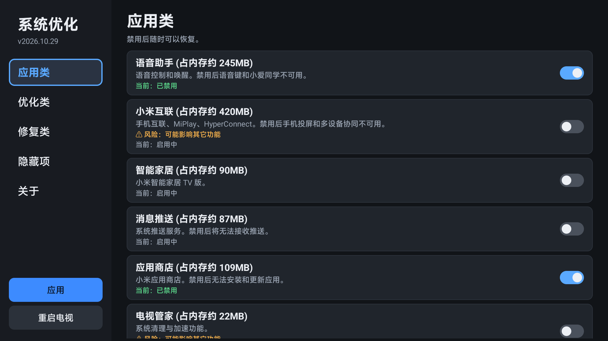
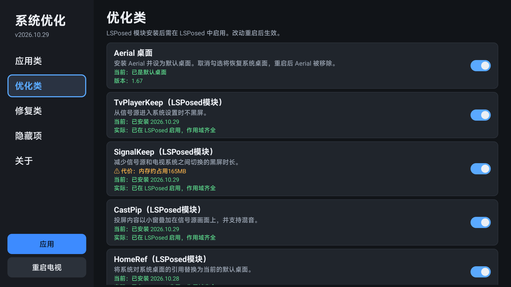

<div align="center">

# MiTV Beekeeper Tools

**小米电视 Mini LED（beekeeper）系统优化工具集。**

通过一个应用统一管理：禁用后台应用、安装精简桌面、安装修复与增强模块，并显示各模块是否实际生效。

适用设备：G Pro 27U（MiTV-MFFU1，HyperOS 3.0.109）；在其他机型上应用将拒绝运行。

<a href="https://github.com/Packeting1/MiTV-Beekeeper-Tools/releases/latest"></a>
<a href="#安装"></a>
<a href="#模块"></a>

<a href="https://github.com/Packeting1/MiTV-Beekeeper-Tools/releases/latest"></a>
<a href="LICENSE"></a>


</div>

> 修改系统存在风险，请在充分了解的前提下使用，后果自行承担。

<div align="center">
 
</div>

## 功能

- **基础**：开启 Magisk Zygisk，安装和更新 Vector。
- **禁用后台应用**：语音助手、统计诊断、云控中心、系统更新、屏保等。勾选即禁用，取消勾选即恢复。
- **Aerial 桌面**：安装Aerial为系统应用并设为默认桌面，可选禁用系统桌面。
- **体验优化**：语音键自定义、电脑麦克风、局部调光强度调节，以及PC杜比视界、图像设置、角标显示等增强。
- **模块管理**：勾选即安装 Magisk / Xposed 模块，取消勾选即移除。
- **隐藏页面入口**：调试信息、色彩校准、开机视频、环绕声测试、MTK 工厂菜单等系统内置的隐藏页面。
- **自动更新**：启动时在后台检查新版本；按顺序尝试多条下载线路，并校验 SHA-256、包名和签名后再安装。

## 安装

前提条件：

- 已 root，并安装 [Magisk](https://github.com/topjohnwu/Magisk)；
- 使用 Xposed 模块时，还需开启 Zygisk 并安装 Xposed 框架（均可在应用的「基础类」完成）。

### 1. 安装应用

下载[最新版 APK](https://github.com/Packeting1/MiTV-Beekeeper-Tools/releases/latest)，通过 ADB 安装到电视（电脑与电视需在同一网络）：

```
adb connect <电视IP>:5555
adb install -r MiTV-Beekeeper-Tools-vX.Y.Z.apk
```

也可以将 APK 复制到 U 盘，在电视的文件管理器中打开安装。

### 2. 使用

在电视应用列表中打开「系统优化」，首次启动时授予 root 权限。勾选所需项目后，点击底部的「应用」。

- **Magisk 模块**：安装后需重启电视。以条目下方显示「实际：已生效」为准。
- **Xposed 模块**：安装并自动勾选作用域。条目下方的「实际」会提示缺少哪一步。

### 升级

有新版本时，应用顶部会显示提示，点击「更新」即可，原有设置保留。Magisk 模块与 Aerial 的新版本同样会提示。

### 还原

取消勾选对应条目并点击「应用」，重启后生效。Magisk 模块也可直接在 Magisk 中移除。被禁用的应用取消勾选即可恢复。

## 模块

### Magisk 模块

| 模块 | 作用 |
| :-- | :-- |
| HGIG Fix | 补全缺失的 HGIG 支持标志，修复 HDR 色调映射菜单错位 |
| LDM Fix | 将局部调光参数恢复为 OS2 的数值，减轻 HDR / 杜比视界过曝 |
| ADB Keeper | 保持 ADB 开关的开启状态 |
| 4K UI Switch | 在「系统设置 > 通用设置」中显示「UI 显示模式」选项 |
| Support HDR10+ | 上报 HDR10+ 能力（实际效果未验证） |
| Support IMAX | 在图像模式中显示「IMAX 模式」 |
| Support AISR Level | 在「图像参数 > 清晰度」中显示超分辨率强度调节 |
| Support Volume Balance | 在声音设置中显示「音量均衡」 |
| Support LLDV | 声明支持低延迟杜比视界，使 Windows 能够识别杜比视界 |
| Support DP Audio | 使 DP 输入声明与 HDMI 相同的音频格式，支持通过 DP 输出比特流 |
| FreeSync Keep Mode | 开启 FreeSync 或杜比视界信号带有游戏标志时，不再自动切换到游戏图像模式 |
| [Decorative Light](modules/xposed/src/decorative-light/README.md) | 自定义装饰灯颜色，支持通过 DDP / sACN（如 OpenRGB）网络控制灯光；可选刷入自定义 MCU 固件，让 24 颗灯珠独立控制 |

### Xposed 模块

| 模块 | 作用 |
| :-- | :-- |
| TvPlayerKeep | 从信号源进入系统设置时不黑屏 |
| SignalKeep | 缩短信号源与电视系统之间切换的黑屏时间 |
| CastPip | 允许投屏内容以小窗叠加在信号源画面之上 |
| HomeRef | 默认桌面不是系统桌面时，使系统的「返回桌面」判断和跳转指向当前默认桌面 |
| InstallUnlock | 解除小米包安装器依据云端黑名单对部分应用的安装拦截 |
| NoSignalAudioMode | 信号源在无信号倒计时结束后进入音响模式，信号恢复时自动亮屏 |
| MoreDisplaySettings | 快捷设置的图像页新增「更多图像设置」入口 |
| GameMenu | 游戏设置条的功能项合并到快捷设置中的「游戏」页，并新增FPS 计数器、计时器、秒表 |
| DolbyVisionTitle | 在杜比视界模式时，快捷设置的标题显示 Dolby Vision |
| MediaBadge | 根据播放内容显示 HDR10 / HLG / Dolby / DTS 等角标，可在快捷设置的「专业功能」页开关显示 |
| SignalInfoBadge | 简化信号源信息角标，可在快捷设置的「专业功能」页开关显示 |
| VoiceKeyMap | 自定义遥控器语音键的单击、双击、长按动作：息屏（音响模式）、切换信号源、启动应用 |
| VolumeBalanceSwitch | 在快捷设置的声音页新增「音量均衡」开关 |
| LocalDimmingMemory | 按视频格式分别记忆精密光控档位，可在快捷设置的「专业功能」页开关 |
| SourceVolumeMemory | 信号源和电视系统分别记住音量，切换时自动恢复，可在快捷设置的「专业功能」页开关 |
| MicStream | 在电脑 [MiTvMic](https://github.com/Packeting1/MiTV-Beekeeper-Tools/releases?q=mitvmic) 上配对电视后，即可作为电脑的麦克风使用，可在快捷设置的「专业功能」页开关 |

## 常见问题

- **只支持 Magisk Zygisk**：应用只适配 Magisk 自带的 Zygisk（「基础」页的「Magisk Zygisk」）和 Vector。NeoZygisk 只注入 64 位进程，电视播放器等 32 位应用里的 Xposed 模块不会生效，因此不再支持。
- **启动时提示迁移环境**：检测到已安装 NeoZygisk、Zygisk Next、Zygote64 Fix 或 LSPosed 时，应用会建议迁移。确认后自动卸载它们，开启 Magisk Zygisk、安装 Vector，并重启电视。选择「暂不」则下次启动再提示，期间「基础」页的 Magisk Zygisk 和 Vector 保持锁定。
- **系统升级之后**：FreeSync Keep Mode、LDM Fix 等依赖具体固件文件的模块会先校验文件，不匹配则自动跳过，不会写入分区。其他模块可能需要针对新版本重新适配。
- **SignalKeep 的代价**：返回桌面时保留信号，内存多占用约 165 MB；在桌面停留超过 1 分钟后自动释放信号。保留期间桌面沿用信号的图像模式（例如信号为杜比视界时，桌面同样按杜比视界显示）。
- **云端配置是否会覆盖开关类模块**：开关类模块将条目写入 `/data/system/mitv.config.xml`，并通过 `chattr +i` 锁定以防云端覆盖；卸载时解除锁定并还原。
- **如何还原**：取消勾选对应条目并重启电视。Magisk 模块也可以在 Magisk 中直接移除。


## 自行构建

不使用 Gradle。需要 JDK 17+、API 28 的 `android.jar`、build-tools（aapt2 / zipalign / apksigner）和 R8。

```
set JAVA_HOME=...
set ANDROID_JAR=...\android.jar
set BUILD_TOOLS=...\build-tools\34.0.0
set R8_JAR=...\r8.jar
set KEYSTORE=...\my.keystore
set KS_PASS=...
set KS_ALIAS=...
set XPOSED_API=...\api-101.0.0.aar
python modules\xposed\build.py [模块名]
python modules\magisk\build.py [模块目录名]
python app\build.py
```

- `XPOSED_API` 为 [libxposed API 101](https://github.com/libxposed/api)，可从 Maven Central 获取。
- Xposed 模块输出到 `modules/xposed/dist/`。Magisk 模块从 `modules/magisk/src/` 打包为 `modules/magisk/dist/` 中的 zip，版本号见各模块的 `module.prop`。应用构建时从这两个 `dist` 目录取用，输出到 `dist/`。
- 内置的 Aerial APK（[pengchujin/aerial-tv](https://github.com/pengchujin/aerial-tv)，MIT）若在 `app/bundled/aerial.apk` 不存在，构建时会自动下载最新 Release，并按 GitHub 提供的 SHA-256 校验。内置的 Vector v2.2（GPL-3.0，[JingMatrix/Vector](https://github.com/JingMatrix/Vector)）放在 `app/bundled/vector.zip`，不存在时构建会下载并按 GitHub 提供的 SHA-256 校验。
- 使用自己的签名时替换 `KEYSTORE`。签名不同的应用无法覆盖安装。

## 贡献

提交前请安装 [pre-commit](https://pre-commit.com)（需要 JDK 11+）：`pip install pre-commit && pre-commit install`。PR 会自动运行同样的检查。

## 许可

[GNU GPL v3.0](LICENSE)。随应用附带的 Aerial 仍遵循其原有的 MIT 许可。

## 致谢

- [Aerial](https://github.com/pengchujin/aerial-tv)（MIT）：随应用附带的桌面
- [Magisk](https://github.com/topjohnwu/Magisk)、[Vector](https://github.com/JingMatrix/Vector)
- [VB-CABLE](https://vb-audio.com/Cable/)（VB-Audio）：MiTvMic 使用的虚拟声卡驱动
- 贡献者：[@Rin010](https://github.com/Rin010)（NoSignalAudioMode、Decorative Light）、[@Filey-Aaron](https://github.com/Filey-Aaron)（MediaBadge）、酷安 @伏犬（ADB Keeper、4K UI Switch）
