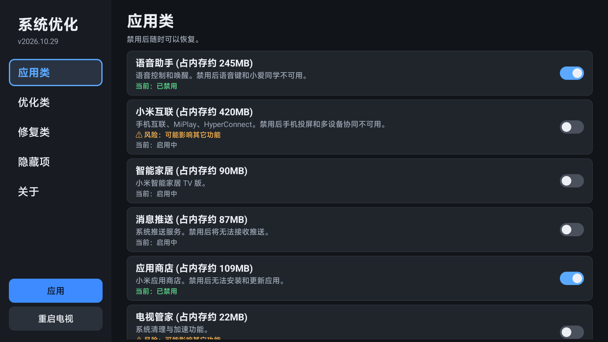
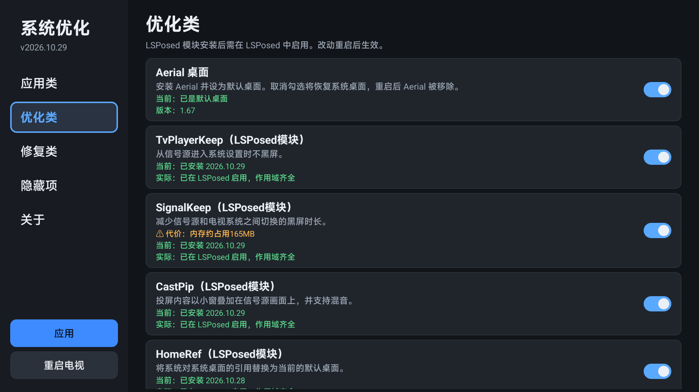

<div align="center">

# MiTV Beekeeper Tools

**小米电视 Mini LED（beekeeper）系统优化工具集。**

通过一个应用统一管理：禁用后台应用、安装精简桌面、安装修复与增强模块，并显示各模块是否实际生效。

适用设备：G Pro 27U（MiTV-MFFU1，HyperOS 3.0.109）；在其他机型上应用将拒绝运行。

<a href="https://github.com/Packeting1/MiTV-Beekeeper-Tools/releases/latest"></a>
<a href="#安装"></a>
<a href="#模块"></a>

<a href="https://github.com/Packeting1/MiTV-Beekeeper-Tools/releases/latest"></a>
<a href="LICENSE"></a>


</div>

> 修改系统存在风险，请在充分了解的前提下使用，后果自行承担。所有模块均可在应用内取消勾选并重启后还原。

<div align="center">
 
</div>

## 解决的问题

| 问题 | 对应模块 |
| :-- | :-- |
| HDR / 杜比视界画面过曝 | LDM Fix：将局部调光参数恢复为 OS2 的数值 |
| 图像设置中 HGIG 选项错位 | HGIG Fix：补全缺失的 HGIG 支持标志 |
| 信号源下进入系统设置时黑屏 | TvPlayerKeep：设置键和图像参数页不再黑屏 |
| 信号源与系统桌面切换时黑屏时间长 | SignalKeep：返回桌面时保留信号 |
| Windows 中没有杜比视界选项 | Support LLDV：声明支持低延迟杜比视界（LLDV） |
| DP 输入的声道数与音频编码格式受限 | Support DP Audio：DP 声明与 HDMI 相同的音频格式，支持比特流输出 |
| 开启 FreeSync 后自动切换图像游戏模式 | FreeSync Keep Mode：保持当前图像模式 |
| 小米包安装器拦截部分应用的安装 | InstallUnlock：解除依据云端黑名单的拦截 |
| 后台应用过多 | 应用内一键禁用，可随时恢复 |

## 功能

- **禁用后台应用**：语音助手、统计诊断、云控中心、屏保等。勾选即禁用，取消勾选即恢复；条目标题中标注了实测的内存占用。
- **Aerial 桌面**：安装为系统应用并设为默认桌面（[Aerial](https://github.com/pengchujin/aerial-tv)，无广告、无推荐流）。可选禁用系统桌面，启动时检测 Aerial 的新版本。
- **模块管理**：勾选即安装 Magisk / LSPosed 模块，取消勾选即移除。各条目下方的「实际：…」由 root 脚本读取，反映真实状态：已生效、未生效（需重启）、未在 LSPosed 中启用、作用域缺失项等。
- **隐藏页面入口**：调试信息、色彩校准、开机视频、环绕声测试、MTK 工厂菜单等系统内置的隐藏页面。
- **自动更新**：启动时在后台检查新版本；按顺序尝试多条下载线路，并校验 SHA-256、包名和签名后再安装。

## 安装

前提条件：

- 已 root，并安装 [Magisk](https://github.com/topjohnwu/Magisk)（在 31.0 上测试）和 [Zygisk Next](https://github.com/Dr-TSNG/ZygiskNext)；
- 使用 LSPosed 模块时，还需安装 [LSPosed / Vector](https://github.com/LSPosed/LSPosed)。

### 1. 安装应用

下载[最新版 APK](https://github.com/Packeting1/MiTV-Beekeeper-Tools/releases/latest)，通过 ADB 安装到电视（电脑与电视需在同一网络）：

```
adb connect <电视IP>:5555
adb install -r MiTV-Beekeeper-Tools-vX.Y.Z.apk
```

也可以将 APK 复制到 U 盘，在电视的文件管理器中打开安装。

### 2. 使用

在电视应用列表中打开「系统优化」，首次启动时授予 root 权限。勾选所需项目后，点击底部的「应用」。

- **Magisk 模块**：安装后需重启电视。以条目下方显示「实际：已生效」为准。
- **LSPosed 模块**：应用仅负责安装。安装后须在 LSPosed / Vector 中**启用该模块并勾选作用域**，然后重启对应进程或电视。条目下方的「实际」会提示缺少哪一步。

### 升级

有新版本时，应用顶部会显示提示，点击「更新」即可，原有设置保留。Magisk 模块与 Aerial 的新版本同样会提示。

### 还原

取消勾选对应条目并点击「应用」，重启后生效。Magisk 模块也可直接在 Magisk 中移除。被禁用的应用取消勾选即可恢复。

## 模块

### Magisk 模块

| 模块 | 作用 |
| :-- | :-- |
| HGIG Fix | 补全缺失的 HGIG 支持标志，修复 HDR 色调映射菜单错位 |
| LDM Fix | 将局部调光参数恢复为 OS2 的数值，减轻 HDR / 杜比视界过曝 |
| Zygote64 Fix | 修复 Zygisk Next 遗漏注入 zygote64 的问题，使 LSPosed 钩子在开机后生效 |
| ADB Keeper | 开机和系统重置后保持 ADB 与 TCP 端口开启 |
| 4K UI Switch | 在系统设置中显示 4K UI 分辨率开关 |
| Support HDR10+ | 上报 HDR10+ 能力（⚠️ 实际效果未验证） |
| Support IMAX | 在图像模式中显示 IMAX |
| Support AISR Level | 在「图像参数 > 清晰度」中显示超分辨率强度调节 |
| Support Volume Balance | 在声音设置中显示音量均衡 |
| Support LLDV | 声明支持低延迟杜比视界（LLDV），使 Windows 能够识别杜比视界 |
| Support DP Audio | 使 DP 输入声明与 HDMI 相同的音频格式，支持通过 DP 输出比特流 |
| FreeSync Keep Mode | 开启 FreeSync，或杜比视界信号带有游戏标志时，不再自动切换到游戏模式 |

### LSPosed 模块

| 模块 | 作用 |
| :-- | :-- |
| TvPlayerKeep | 从信号源进入系统设置时不黑屏 |
| SignalKeep | 缩短信号源与电视系统之间切换的黑屏时间 |
| CastPip | 投屏内容以小窗叠加在信号源画面上 |
| HomeRef | 默认桌面不是系统桌面时，使系统的「返回桌面」判断和跳转指向当前默认桌面 |
| InstallUnlock | 解除小米包安装器依据云端黑名单对部分应用的安装拦截 |
| NoSignalAudioMode | 信号源在无信号倒计时结束后进入音响模式，信号恢复时自动亮屏 |
| MoreDisplaySettings | 在菜单键悬浮窗的图像页新增「更多图像设置」入口 |
| DolbyVisionTitle | 菜单键设置界面的标题在所有杜比视界图像模式下均显示 Dolby Vision |
| MediaBadge | 根据播放内容显示 HDR10 / HLG / HDR Vivid / Dolby Vision / Technicolor 角标，以及 Dolby / DTS 系列音频角标 |

## 常见问题

- **安装 LSPosed 模块后没有效果**：应用仅负责安装。请在 LSPosed / Vector 中启用该模块并勾选作用域，再重启对应进程或电视。条目下方的「实际：…」会说明缺少哪一步。
- **Magisk 提示「Zygisk 未启用，此模块暂停加载」**：这是 Magisk 自身的提示文案，使用 Zygisk Next 时属于误报。请勿同时开启两个 Zygisk。
- **系统升级之后**：FreeSync Keep Mode、LDM Fix 等依赖具体固件文件的模块会先校验文件，不匹配则自动跳过，不会写入分区。其他模块可能需要针对新版本重新适配。
- **SignalKeep 的代价**：返回桌面时保留信号，内存多占用约 165 MB；在桌面停留超过 1 分钟后自动释放信号。保留期间桌面沿用信号的图像模式（例如 PC 为杜比视界时，桌面同样按杜比视界显示）。
- **云端配置是否会覆盖开关类模块**：开关类模块将条目写入 `/data/system/mitv.config.xml`，并通过 `chattr +i` 锁定以防云端覆盖；卸载时解除锁定并还原。
- **如何还原**：取消勾选对应条目并重启电视。Magisk 模块也可以在 Magisk 中直接移除。

## 工作原理

- **开关类模块**：设置应用依据 `mitv.config.xml` 中的开关决定是否显示相应功能。模块在开机时、TvService 读取配置之前补全对应条目。
- **LDM Fix**：显示驱动在开机早期读取 `ldm.ini`，早于 Magisk 的启动脚本，因此只能直接修改分区内的文件；写入前会先校验原文件。
- **Support LLDV / DP Audio**：修改电视向电脑提供的 EDID，加入 Windows 识别杜比视界与音频格式所需的描述符；卸载时按备份还原。
- **FreeSync Keep Mode**：在开机早期，将打过补丁的 `libmtkapp.so` 绑定挂载到只读分区中的原路径。分区本身不被修改，重启后即恢复。
- **LSPosed 模块**：钩取电视系统应用（播放器、设置、TvService 等）中的特定方法。这些方法依赖 3.0.109 的类名；系统升级后若找不到，仅记录日志，不会导致崩溃。

## 自行构建

不使用 Gradle。需要 JDK 17+、API 28 的 `android.jar`、build-tools（aapt2 / zipalign / apksigner）和 R8。

```
set JAVA_HOME=...
set ANDROID_JAR=...\android.jar
set BUILD_TOOLS=...\build-tools\34.0.0
set R8_JAR=...\r8.jar
set KEYSTORE=...\my.keystore
set KS_PASS=...
set KS_ALIAS=...
set XPOSED_API=...\api-101.0.0.aar
python modules\lsposed\build.py [模块名]
python modules\magisk\build.py [模块目录名]
python app\build.py
```

- `XPOSED_API` 为 [libxposed API 101](https://github.com/libxposed/api)，可从 Maven Central 获取。
- LSPosed 模块输出到 `modules/lsposed/dist/`。Magisk 模块为纯脚本（仅需 Python），从 `modules/magisk/src/` 打包为 `modules/magisk/dist/` 中的 zip，版本号见各模块的 `module.prop`。应用构建时从这两个 `dist` 目录取用，输出到 `dist/`。
- 内置的 Aerial APK（[pengchujin/aerial-tv](https://github.com/pengchujin/aerial-tv)，MIT）若在 `app/bundled/aerial.apk` 不存在，构建时会自动下载最新 Release，并按 GitHub 提供的 SHA-256 校验。
- 使用自己的签名时替换 `KEYSTORE`。签名不同的应用无法覆盖安装。

## 许可

[GNU GPL v3.0](LICENSE)。随应用附带的 Aerial 仍遵循其原有的 MIT 许可。

## 致谢

- [Aerial](https://github.com/pengchujin/aerial-tv)（MIT）：随应用附带的桌面
- [Magisk](https://github.com/topjohnwu/Magisk)、[LSPosed](https://github.com/LSPosed/LSPosed)、[Zygisk Next](https://github.com/Dr-TSNG/ZygiskNext)
- 贡献者：[@Rin010](https://github.com/Rin010)（NoSignalAudioMode）、[@Filey-Aaron](https://github.com/Filey-Aaron)（MediaBadge）、酷安 @伏犬（ADB Keeper、4K UI Switch）
